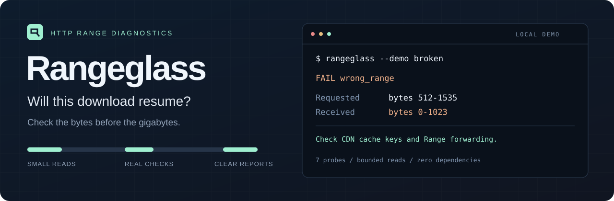

<p align="center">
  
</p>

<p align="center">
  <a href="https://github.com/zare5/rangeglass/actions/workflows/ci.yml"></a>
  <a href="https://github.com/zare5/rangeglass/releases"></a>
  
  <a href="LICENSE"></a>
</p>

<p align="center"><a href="README.zh-CN.md">简体中文</a> · <a href="#try-it">Try it</a> · <a href="#what-it-checks">Checks</a> · <a href="docs/report-format.md">JSON reference</a></p>

# Rangeglass

**See whether a download URL really supports HTTP ranges and conditional resume.**

A small command-line tool for debugging interrupted downloads, broken CDN byte ranges, and files that corrupt when downloaded in chunks. It makes real range requests, checks the responses against each other, and explains what went wrong.

- **Check bytes, not promises.** Tests offsets, overlapping content, lengths, ETags, and `If-Range` behavior.
- **Small reads.** At most **7,175 response-body bytes** with the default settings, even when a server ignores `Range`.
- **Easy to share.** Plain-text findings, suggested next steps, and versioned JSON reports.
- **No runtime dependencies.** Python standard library; Windows, macOS, and Linux. No account or service.

Use it before fetching a large model, when a release download keeps restarting, or while configuring an object-store proxy. It diagnoses one URL; your existing downloader still does the downloading.

## Try it

Requires Python 3.10+ and Git for this installation method:

```sh
python -m pip install "git+https://github.com/zare5/rangeglass.git@v0.1.0"
rangeglass "https://example.com/large-file.bin"
```

Replace the example URL with a **direct file link**, not a file-sharing page.

**Without Git:** download the wheel from [Releases](https://github.com/zare5/rangeglass/releases/latest), then run `python -m pip install rangeglass-0.1.0-py3-none-any.whl`.

**Without installing a package:** download `rangeglass.pyz` from the same release and run `python rangeglass.pyz "URL"`.

**Windows without Python:** download `rangeglass-windows-x64.exe` and run it in PowerShell:

```powershell
.\rangeglass-windows-x64.exe --demo good
.\rangeglass-windows-x64.exe "https://example.com/large-file.bin"
```

The Windows executable is a console program; run it from a terminal. It is unsigned. There is no PyPI release at present; use the installation paths above.

### A demo you can run offline

```sh
rangeglass --demo good
rangeglass --demo broken
```

These start a temporary loopback server and close it when the check finishes. The broken demo deliberately returns the first chunk for every requested offset, and exits **1**:

```text
FAIL - inconsistent or unsafe-to-combine responses observed

Resource: 8,192 bytes | ETag: strong
Read: 6,145 body bytes across 7 probes

  prefix              206  bytes 0-1023/8192
  overlap             206  bytes 0-1023/8192
  middle              206  bytes 0-1023/8192
  suffix              206  bytes 0-1023/8192
  if_range_match      206  bytes 0-1023/8192
  if_range_mismatch   200  -
  past_end            416  bytes */8192

[ERROR] wrong_range (overlap)
  Requested 512-1535; received 0-1023.
  Next: Check CDN cache keys and proxy forwarding of the Range header.
```

This is an excerpt of actual demo output. `--demo ignores-range` shows a server that advertises ranges but responds with the entire file.

## What it checks

| Probe | Question |
| --- | --- |
| Prefix | Does a real `Range` GET return a valid `206` with the right number of bytes? |
| Overlap | Do two responses agree about bytes they have in common? |
| Middle | Does a nonzero offset return the requested part, with the same total size and ETag? |
| Suffix | Does `bytes=-1024` return the end of the file? |
| Matching `If-Range` | Does a strong ETag allow a repeat partial response with consistent bytes? |
| Mismatching `If-Range` | Does a different validator correctly cause a full `200` response? |
| Past the end | Does an out-of-bounds range return `416` and the expected total size? |

Every probe requests `Accept-Encoding: identity`. Reads stop after `sample_bytes + 1` bytes, and redirect bodies are not read. A complete scan uses up to seven probes; redirects can add requests, with a limit of five hops per probe. Earlier failures or an unknown size can stop the scan early.

The byte cap describes bytes read by the application, **not** TCP/TLS overhead, socket buffering, or traffic between a CDN and its origin. A tiny request can still trigger a large origin fetch on some CDNs.

### Reading the result

| Verdict | Meaning | Exit |
| --- | --- | --- |
| `PASS` | The sampled checks passed. | `0` |
| `WARN` | Ranges worked with caveats, such as a missing strong ETag. | `0`, or `1` with `--strict` |
| `FAIL` | Observed conflicting content or responses that cannot safely be combined as requested. | `1` |
| `UNSUPPORTED` | The initial range request was ignored. This is allowed by HTTP; it prevents this resume method. | `1` |
| `INCONCLUSIVE` | Network/authentication trouble, an empty file, or insufficient size information prevented completion. | `2` |

Always verify the downloaded file against a trusted checksum. A passing sample cannot prove every byte is correct or that a signed URL will still work tomorrow.

## Useful commands

```sh
# Produce a report for an issue or a CI check.
rangeglass "https://example.com/file.zip" --json > report.json

# Treat warnings as a failing check.
rangeglass "https://example.com/file.zip" --strict

# Larger samples; a 20-second socket timeout and body-loop time budget.
rangeglass "https://example.com/file.zip" --sample-bytes 4096 --timeout 20

# Ignore system/environment proxy settings for a direct comparison.
rangeglass "https://example.com/file.zip" --no-proxy
```

For authenticated links, read a complete header value from an environment variable:

```powershell
# PowerShell; set DOWNLOAD_AUTH using your normal secret-management method.
rangeglass "https://example.com/private.bin" --header-env Authorization=DOWNLOAD_AUTH
```

`DOWNLOAD_AUTH` should contain the full value, such as `Bearer …`. Bash uses the same command. `-H "Name: value"` is also supported, but shell history may retain literal values. Do not override probe headers such as `Range`, `If-Range`, or `Accept-Encoding`.

Reports remove URL query strings and fragments and omit custom request-header values. **Hostnames and URL paths remain visible**; review reports before sharing. All custom headers are stripped when a redirect crosses an origin (scheme, host, or port). HTTPS-to-HTTP redirects are rejected. Standard Python/system proxy and TLS settings apply; TLS certificate verification stays enabled.

## Why this exists

`Accept-Ranges: bytes` is advice, not a guarantee. [RFC 9110 explicitly says clients cannot assume future range requests will succeed](https://www.rfc-editor.org/rfc/rfc9110.html#section-14.3).

This still causes practical failures: an [October 2026 GitLab Runner fix](https://gitlab.com/gitlab-org/gitlab-runner/-/merge_requests/7635) addresses parallel downloads that accepted full or wrong-range responses and produced corrupt archives. [Magda's July 2026 range-support request](https://github.com/magda-io/magda/issues/3673) also describes interrupted downloads restarting from byte zero.

Rangeglass packages a small set of diagnostic requests into a repeatable report. See the [research notes and alternatives](docs/research.md) for the scope and evidence behind the project.

| Tool | Good fit |
| --- | --- |
| `curl -I` | Inspect advertised headers. |
| `curl -r` / HTTPie | Make a specific range request and inspect its raw response. |
| curl / wget / aria2 | Download and resume files. |
| [badhttp](https://badhttp.dev/) | Test your HTTP **client** against deliberately broken servers. |
| **Rangeglass** | Check a download **endpoint** with multiple bounded probes and a readable verdict. |

## Scope and limits

- HTTP/1.1, single byte ranges, and strong ETag-based `If-Range`. It does not test HTTP/2, HTTP/3, multi-range bodies, date validators, browser CORS, or download speed.
- A missing strong ETag is a warning, not proof that resume is impossible. Immutable URLs and correctly implemented date validators can also work.
- Unknown total size and empty resources are inconclusive. A shorter range beginning at the requested offset is accepted with a warning; other subsets are conservatively rejected.
- Only sampled overlaps are compared. Incorrect bytes in unsampled portions can go undetected. A changing resource may fail even if each response is individually valid.
- HTTP permits a server to ignore a range. A failure here describes suitability for the requested chunk/resume workflow, not necessarily a server vulnerability.
- Timeouts limit socket operations and the body-read loop; they are not a whole-command deadline. DNS and slow response headers can take longer.
- The tool only makes GET requests and does not save payloads. Requests can still count toward quotas, access logs, or one-time-link usage.

## Development

```sh
git clone https://github.com/zare5/rangeglass.git
cd rangeglass
python -m pip install -e .
python -m unittest discover -s tests -t . -v
```

Tests run against local HTTP fixtures: correct ranges, ignored and incorrect offsets, truncated and oversized bodies, chunked responses, changing resources, conditional requests, redirects, authentication boundaries, and CLI exit codes. CI runs on Linux, Windows, and macOS with Python 3.10 and 3.14.

Contributions: [CONTRIBUTING.md](CONTRIBUTING.md). Release history: [CHANGELOG.md](CHANGELOG.md).

MIT licensed. Created by [zare5](https://github.com/zare5).
