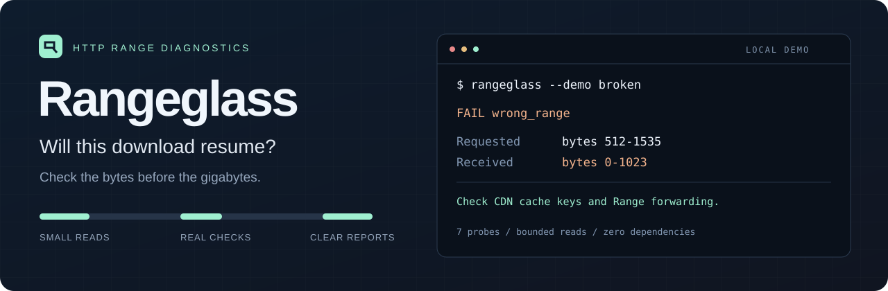

<p align="center"></p>

# Rangeglass：HTTP Range 与断点续传检查工具

**下载大文件之前，先检查这个链接能否正确断点续传。**

[English](README.md) · [下载版本](https://github.com/zare5/rangeglass/releases/latest) · [JSON 格式](docs/report-format.md)

一个小巧的命令行工具，用来排查下载中断、CDN 返回错误分片、分段下载后文件损坏等问题。它实际请求文件的不同位置，核对响应内容，输出原因和下一步建议。

- 检查真实字节、偏移、长度、ETag 和 `If-Range`，不只看服务器的声明。
- 默认最多读取 **8,200 字节的响应正文**（包含可选的尾部回退检查），服务器忽略 Range 时也会停止读取。
- 支持文本、可直接贴到 Issue 的 Markdown，以及 JSON 报告。
- Python 3.10+，零运行时依赖，支持 Windows、macOS、Linux。

适合下载模型、镜像、发布包之前检查链接，也适合维护文件服务、对象存储代理和 CDN 的开发者。它负责诊断，下载仍交给你习惯的工具。

## 什么情况下值得用

| 遇到的问题 | 它能检查什么 |
| --- | --- |
| 下载中断后总是从头开始 | 文件直链是否真的支持 HTTP 字节范围请求 |
| curl 33、`curl -C -` 无法续传 | 服务器返回的是 206 分片，还是忽略请求的 200 完整响应 |
| 多线程下载后文件损坏 | 错误 Content-Range、错分片、内容变化、长度不一致 |
| 修改了 Nginx、CDN、反向代理或对象存储配置 | 这条访问路径上的分片和 If-Range 是否正常 |
| 签名链接出现 403、服务返回 429 | 区分权限/过期/限流导致的检查中断与分片协议错误 |

最适合的是**开发者、自托管用户和维护下载服务的人**。普通用户下载正常文件时不需要每次运行它。它不会加速下载、自动修复损坏文件，也不能检查已下载模型的全部内容。

## 安装与使用

安装了 Python 和 Git 的用户：

```sh
python -m pip install "git+https://github.com/zare5/rangeglass.git@v0.2.0"
rangeglass "https://example.com/large-file.bin"
```

请把示例地址替换成**文件直链**，不是网盘介绍页。

也可以从 [Releases](https://github.com/zare5/rangeglass/releases/latest) 下载：

| 文件 | 用法 |
| --- | --- |
| `rangeglass-windows-x64.exe` | 无需 Python，在 PowerShell 运行 `./rangeglass-windows-x64.exe "URL"` |
| `rangeglass.pyz` | 无需安装 Python 包，运行 `python rangeglass.pyz "URL"` |
| `rangeglass-0.2.0-py3-none-any.whl` | 无需 Git，运行 `python -m pip install 文件名.whl` |

Windows 版是命令行程序，需要在终端里运行；尚未进行代码签名。目前未发布到 PyPI，不要使用省略来源的 `pip install rangeglass`。

## 先看一个离线演示

```sh
rangeglass --demo good
rangeglass --demo broken
```

演示会临时启动本机服务器，检查后关闭，不需要联网。故障示例会故意把文件开头的数据当作每一个分片返回：

```text
[ERROR] wrong_range (overlap)
  Requested 512-1535; received 0-1023.
  Next: Check CDN cache keys and proxy forwarding of the Range header.
```

意思是“我请求 512–1535 字节，你却返回了 0–1023 字节”，常见原因是代理没有正确转发 Range，或 CDN 缓存没有区分不同片段。`--demo broken` 预期退出码为 1。

## 它检查什么

1. 开头：是否真的返回 `206`、有效 Content-Range 和正确长度？
2. 重叠片段：同一位置的字节是否一致？
3. 中间：非零偏移是否正确，文件总大小和 ETag 是否稳定？
4. 结尾：后缀范围请求是否正常？若返回 501，再检查一次明确的尾部字节区间，并报告限制。
5. 匹配的 If-Range：文件标识没变时能否继续返回分片？
6. 不匹配的 If-Range：是否退回完整响应，且长度、编码、ETag 和抽样字节一致？
7. 越界请求：是否返回 `416` 和正确的总大小？

扫描包含七项核心探测，后缀语法返回 501 时最多追加一次明确尾部区间检查；每次最多五次重定向。字节上限仅针对程序读取的正文，不包括网络缓冲、协议开销或 CDN 回源流量。

## 结果与退出码

| 结果 | 含义 | 退出码 |
| --- | --- | --- |
| PASS | 本次抽样检查通过 | 0 |
| WARN | 存在注意事项，例如没有强 ETag | 0；加 `--strict` 后为 1 |
| FAIL | 发现错误片段、内容变化或不可靠的续传条件 | 1 |
| UNSUPPORTED | 服务器忽略了 Range，本次无法使用这种续传方式 | 1 |
| INCONCLUSIVE | 网络、权限、空文件或未知大小导致无法完成检查 | 2 |

遇到权限、限流或服务错误时会停止后续请求。如果此前已经观察到明确的错误片段，结论仍保留为 FAIL，同时列出后来发生的请求错误。合法的“只返回所请求范围的一部分”会提示警告。

```sh
rangeglass "URL" --json > report.json
rangeglass "URL" --markdown > rangeglass-report.md
rangeglass "URL" --strict
rangeglass "URL" --sample-bytes 4096 --timeout 20
rangeglass "URL" --no-proxy
```

需要认证时，先通过你习惯的方式把完整请求头值（例如 `Bearer …`）存入环境变量，再运行：

```sh
rangeglass "URL" --header-env Authorization=DOWNLOAD_AUTH
```

报告会遮掉 URL 查询参数和片段，也不会记录自定义请求头值，但仍保留主机名和路径，分享前请检查。跨源重定向会移除全部自定义请求头；不接受 HTTPS 降级到 HTTP。默认遵循 Python 的系统代理和 TLS 设置。

## 为什么做这个

这不是凭空假设的需求：[GitLab Runner 在 2026 年 10 月的修复](https://gitlab.com/gitlab-org/gitlab-runner/-/merge_requests/7635)涉及分段下载接受错误响应、最后生成损坏文件的问题。[Magda 在 2026 年 7 月的需求](https://github.com/magda-io/magda/issues/3673)也提到大文件中断后必须从头下载。

目前已有 curl、wget、aria2 等成熟下载工具。Rangeglass 的定位是把排查步骤收进一个小命令，给出明确证据和报告。[调研依据与取舍](docs/research.md)保留了来源和替代方案；不宣称市场上没有其他类似实现。

## 已知边界

这是抽样检查，不能代替完整文件校验，也不能保证临时签名链接之后不会过期。下载结束后仍应核对可信来源的校验和。

当前检查 HTTP/1.1 单范围请求和强 ETag 条件续传，不检测 HTTP/2、HTTP/3、CORS、下载速度或日期形式的 If-Range。缺少强 ETag 会给出警告，不代表所有续传方法都不可用。未知总大小、空文件会返回“无法确认”。超时不是整个命令的硬截止时间。

## 常见问题

**它对 curl 33、服务器不支持 byte ranges 有帮助吗？** 有。它通过真实请求检查是否返回 206、范围是否正确，以及是否遇到权限或限流错误。但它不知道你本地已经下载了一半的文件是否正确，也不会替你续传。

**能检查 Hugging Face 模型、Nginx、Cloudflare 或 S3 下载吗？** 可以检查它们提供的普通 HTTP(S) 文件直链；需要登录时仍须提供合法认证。结果只代表这次 URL、网络路径和凭据的表现，并不是对整个服务商的认证。

**报告通过就一定不会坏吗？** 不能这样理解。未抽样的位置仍可能有问题，文件也可能在之后变化，签名链接仍可能过期。完整下载后需要核对可信校验和。

## 开发

```sh
python -m pip install -e .
python -m unittest discover -s tests -t . -v
```

测试使用本地模拟服务器。CI 覆盖 Windows、macOS、Linux，以及 Python 3.10 和 3.14。

[贡献说明](CONTRIBUTING.md) · [版本记录](CHANGELOG.md) · [审查结论与升级优先级](docs/review-2026-11-07.md) · [MIT 许可证](LICENSE)
